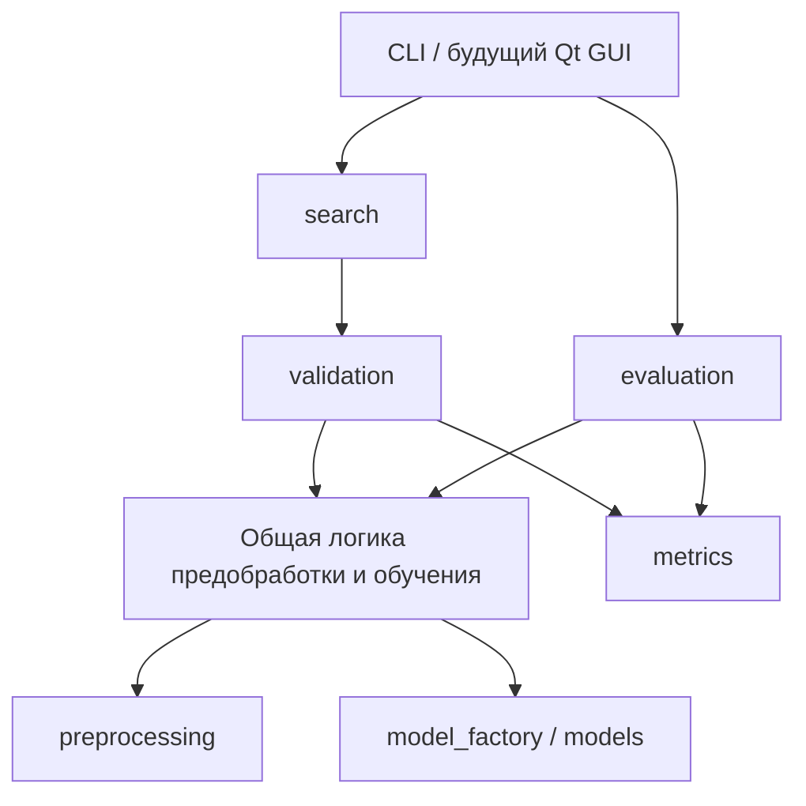

# Работа 5. Подбор параметров и воспроизводимый эксперимент

В работе создаются библиотека ядра и три самостоятельных CLI-приложения:

1. `prepare_data` сохраняет исходные train/test, параметры разбиения и статистики.
2. `tune_model` подбирает параметры с кросс-валидацией на train и сохраняет
   конкретные конфигурации лучших моделей.
3. `evaluate_model` заново обучает выбранную конфигурацию на всём train,
   получает предсказания и считает метрики.

Предобработка настраивается отдельным YAML/JSON-конфигом и обучается внутри
каждого фолда. Её настройки в поиске не подбираются. Классификация использует
стратификацию. Grid search последовательный; для долгих экспериментов можно
реализовать простой случайный поиск с фиксированным бюджетом.

[Общий обзор курса](../README.md)

## Условия

- [Основной трек](lab_5_standard.md): сравнение бэггинга kNN и NW, подбор
  параметров, метрики, независимые приложения и отчёт с ИИ-агентом.
- [Задание со звёздочкой](lab_5_star.md): общая инфраструктура сохраняется,
  эксперимент kNN/NW заменяется сравнением глубокого и мелкого random forest;
  добавляется permutation importance исходных признаков до one-hot.

Для своей задачи выполняется полный эксперимент, для второй — небольшой
сквозной проверочный запуск. Метрики регрессии: MSE, MAE, R²; классификации:
accuracy, macro-precision, macro-recall, macro-F1. Матрицу ошибок выводить
не требуется. Метрика выбора фиксируется в `scoring`.

Первоначальный отчёт по результатам эксперимента составляет ИИ-агент.
Студент проверяет его по артефактам и отдельно обосновывает согласие или
несогласие с выводами.

## Рекомендуемая структура проекта

**Это рекомендация, а не обязательный шаблон. Единственного идеального паттерна
организации каталогов C++-проекта нет.** Сохраняйте разумную структуру,
принятую в предыдущих работах, если границы ответственности в ней понятны.
Не нужно переносить файлы только ради буквального совпадения с примером.

```text
project/
├── CMakeLists.txt
├── README.md
├── AGENTS.md
├── include/
│   └── ml/
│       ├── data/
│       ├── preprocessing/
│       ├── models/
│       ├── config/
│       ├── model_factory.hpp
│       ├── metrics.hpp
│       ├── validation.hpp
│       ├── search.hpp
│       └── evaluation.hpp
├── src/
│   ├── data/
│   ├── preprocessing/
│   ├── models/
│   ├── config/
│   ├── model_factory.cpp
│   ├── metrics.cpp
│   ├── validation.cpp
│   ├── search.cpp
│   └── evaluation.cpp
├── apps/
│   ├── prepare_data/
│   │   └── main.cpp
│   ├── tune_model/
│   │   └── main.cpp
│   └── evaluate_model/
│       └── main.cpp
├── tests/
├── configs/
│   ├── preprocessing.yaml
│   ├── search_knn.yaml
│   ├── search_nw.yaml
│   └── smoke_test.yaml
├── docs/
│   ├── report.md
│   └── agent_log/
│       └── lab_5.md
├── data/
└── results/
```

`ml` — условное имя библиотеки и пространства имён. В звёздочке вместо конфигов
kNN/NW располагаются конфиги глубокого и мелкого лесов; при необходимости
добавляется `feature_importance.hpp/.cpp`.

| Каталог | Назначение |
|---|---|
| `include/ml/` | Заголовки библиотеки, доступные приложениям: например, `#include <ml/search.hpp>` |
| `src/` | Реализация библиотеки и внутренние вспомогательные заголовки |
| `apps/` | CLI-аргументы, сообщения пользователю и сценарии отдельных приложений |
| `tests/` | Тесты той же библиотеки; небольшие тестовые данные можно хранить здесь |
| `configs/` | Рабочие примеры конфигов, включая маленький запуск второй задачи |
| `docs/` | Отчёт, пояснения и журнал работы с агентом |
| `data/` | Исходные данные и сохранённые части; большие файлы обычно не коммитятся |
| `results/` | Статистики, результаты поиска, выбранные конфиги, метрики и предсказания |

Собранные программы и промежуточные файлы сборки размещайте в отдельном
каталоге, например `build/`, исключённом из Git. Небольшие артефакты итогового
эксперимента сохраняйте в репозитории; большие данные/результаты сопровождайте
инструкцией получения. Не создавайте множество пустых каталогов на будущее.
Для небольшого модуля достаточно пары `.hpp/.cpp`; отдельный каталог нужен,
когда это упрощает навигацию.

## Границы модулей

| Часть ядра | Ответственность |
|---|---|
| `data` | Данные, ввод/вывод, статистики |
| `preprocessing` | Обучение и применение преобразований |
| `models` | Модели и ансамбли |
| `config` | YAML/JSON и типизированные настройки |
| `model_factory` | Создание новой модели по конкретным настройкам |
| `metrics` | Метрики и направление оптимизации |
| `validation` | Фолды и оценка одной конфигурации |
| `search` | Кандидаты и выбор лучшей конфигурации |
| `evaluation` | Итоговый эксперимент; в звёздочке — важность признаков |



Диаграмма показывает основные вызовы; чтение данных и конфигов здесь опущено.
Общая логика может быть функциями, использующими предобработку и модель.
**Отдельный класс `Pipeline` не обязателен.** Не требуется создавать класс для
каждой строки таблицы или отдельную библиотеку для каждого модуля.

`search` получает обычные настройки и использует `validation` для оценки
кандидатов на одинаковых фолдах. `validation` и `evaluation` используют общую
логику обучения и метрики. Модели не читают YAML/JSON и не знают об именах
выходных файлов. Входные структуры и результаты должны быть пригодны для
использования как CLI, так и будущим GUI.

## CMake и независимые приложения

Для этой работы достаточно одной библиотечной цели, например `ml_core`,
трёх исполняемых целей и тестов. Каждое приложение связывается с `ml_core`:

```cmake
# Фрагмент после объявления библиотеки и её исходных файлов.
target_compile_features(ml_core PUBLIC cxx_std_20)
target_include_directories(ml_core PUBLIC
    "${CMAKE_CURRENT_SOURCE_DIR}/include"
)

add_executable(prepare_data apps/prepare_data/main.cpp)
add_executable(tune_model apps/tune_model/main.cpp)
add_executable(evaluate_model apps/evaluate_model/main.cpp)

foreach(app IN ITEMS prepare_data tune_model evaluate_model)
    target_link_libraries(${app} PRIVATE ml_core)
endforeach()
```

Это фрагмент, а не готовый `CMakeLists.txt`: сохраните подключение исходников,
зависимостей, тестов, предупреждений и санитайзеров вашего проекта. При росте
проекта можно использовать `add_subdirectory`; это не обязательная часть работы.
Установку пакета и экспорт для `find_package` реализовывать не требуется.

Приложения не подключают файлы из `src/` и не включают `.cpp`. Код библиотеки
не зависит от исполняемых целей. В следующей работе рядом может появиться
`apps/gui/`: Qt-приложение связывается с тем же ядром и вызывает его функции,
а не запускает CLI-процессы. Зависимость от Qt остаётся у GUI, ядро её не получает.

## Что описать в README своего проекта

Укажите зависимости и команды сборки/CTest, источник и схему данных, форматы
сохранения, структуру конфигов и реальные команды всех трёх приложений.
Приведите полный эксперимент своей задачи и короткий запуск второй, расположение
результатов и отчёта. Для звёздочки добавьте команды расчёта важности.
Примеры команд должны соответствовать фактическому интерфейсу вашей программы.

