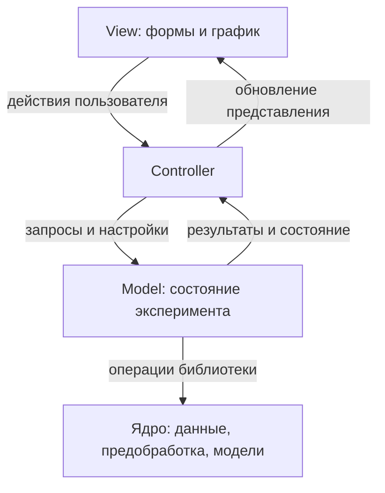

# Работа 6. Qt GUI для исследования моделей

[Условие работы](lab_6.md) включает основной трек и дополнение со звёздочкой.
Используется одна постановка своего датасета и вычислительное ядро работ 1–5.

При запуске пользователь выбирает train/test и конфиги через `QFileDialog`.
Предобработка и модель обучаются один раз на train. Затем приложение показывает
проекции train/test и цветовое поле ответов на двумерном срезе.

- Две оси выбираются из числовых признаков. Остальные признаки фиксируются
  через постоянно видимые поля ввода и списки категорий.
- Все настройки, координаты и подписи — в исходных единицах.
- Область графика квадратная; N означает N × N квадратных экранных клеток.
- Регрессия показывает отклик, классификация — вероятность выбранного класса.
- Зум и перемещение не ограничены диапазонами train; отдельная кнопка возвращает
  исходный вид.
- В основном треке расчёт выполняется по кнопке; устаревшее поле нейтральное,
  кнопка выделена. В звёздочке расчёт идёт автоматически в рабочем потоке.

Точки данных — проекции полных объектов, а поле — срез с фиксированными
остальными признаками. Предсказание полного объекта может отличаться от
значения поля под его маркером.

## Рекомендуемая архитектура MVC

**Это рекомендация, а не обязательная иерархия классов или каталогов.
Единственного идеального паттерна организации C++-проекта нет.** Важно разделить
ответственности и сохранить независимость ядра от интерфейса.

Здесь Model в MVC — состояние и операции приложения, а не только ML-модель.

| Часть | Ответственность |
|---|---|
| Model | Датасеты, обученная предобработка и ML-модель, настройки среза, предсказания и состояние их актуальности |
| View | Формы управления, график, маркеры, подписи, цветовая шкала, карточка объекта |
| Controller | Реакции на действия пользователя, соединения сигналов/слотов, проверка ввода, запуск вычислений и обновление представления |

Например, Model хранит численный результат сетки и описание, для какого среза
он получен. View переводит числа в цвета и экранные координаты. Controller
по изменению осей меняет описание среза, помечает результат неактуальным
и сообщает View, что нужно показать нейтральный фон.



Для простого приложения достаточно `MainWindow`, `SliceWidget`, контроллера
и состояния эксперимента. Не нужен отдельный класс для каждого поля ввода.
`MainWindow` не должен одновременно содержать алгоритмы модели, поиск кандидатов,
все координатные вычисления и механизм фоновых задач.

В ядро можно добавить функции построения среза и обычные структуры
`SliceSpec`/`SliceResult`: индексы осей, границы, фиксированные значения, N,
численные ответы. Их имена и точный состав выбираются самостоятельно.
Они не содержат `QWidget`, `QImage` и других типов Qt. Модель/предобработка
используются через существующие интерфейсы; код ML не копируется в приложение.

### Особенности звёздочки

Добавляется `ExperimentWorker`, работающий в `QThread`. Он выполняет обучение
и предсказания, не обращаясь к виджетам. Controller хранит текущую версию
запроса, принимает только актуальные результаты и управляет последним ожидающим
запросом. Начальное обучение выполняется один раз, затем работник обслуживает
запросы поля.

Владение обученными объектами организуйте так, чтобы GUI не читал изменяемое
состояние во время обучения. Простой вариант — работник владеет предобработкой
и моделью, а GUI получает подготовленные данные для отображения и результаты.
Состояние MVC при этом может быть разделено на данные GUI и вычислительную
часть работника; единый огромный объект Model не требуется.

Межпоточные сообщения несут снимки параметров и результаты с определённым
временем жизни. Если используются собственные типы аргументов queued-сигналов,
проверьте требования Qt к их регистрации и передаче. Не передавайте работнику
ссылки на редактируемые поля формы или временные буферы. Виджеты обновляются
только в GUI-потоке. Устройство сигналов, слотов и потоков реализуется студентом.

## Эффективная отрисовка

Для равномерной сетки достаточно собственного `QWidget`, `QImage` и `QPainter`.
Qt Charts, OpenGL и сторонняя библиотека графиков не требуются.

Рекомендуемая схема:

1. Сохранить численные ответы для N × N центров клеток.
2. Создать `QImage(N, N, QImage::Format_RGB32)`.
3. Каждому пикселю присвоить цвет соответствующей клетки. Для массового
   заполнения удобно использовать `scanLine()` и `QRgb*`.
4. В `paintEvent` отобразить изображение на квадратный участок одним
   `QPainter::drawImage`. `SmoothPixmapTransform` для поля выключен:
   каждый пиксель исходного изображения должен стать одноцветной клеткой.
5. Поверх нарисовать маркеры, оси и подписи; рядом — цветовую шкалу.

Один пиксель этого маленького изображения — **одна клетка модели**, а не один
пиксель окна. Значения модели не вычисляются для каждого экранного пикселя.
При размещении математического нижнего ряда учитывайте перевёрнутое направление
экранной оси Y. Округление границ на растровом экране может дать различие
в один пиксель; геометрически клетки должны иметь одинаковую ширину и высоту.

Храните численный результат отдельно от картинки. Смена видимости маркеров
требует перерисовки, а не вызова модели. Ресайз квадратной области без изменения
математических границ только масштабирует прежнее изображение. После зума
требуется новый численный результат для новых центров.

До первого расчёта и после изменения параметров рисуйте нейтральную заглушку
с понятной подписью. В основном треке подсвечивайте «Построить поле»; не
вычисляйте ответы внутри `paintEvent`, `mouseMoveEvent` или обработчика ресайза.
В звёздочке эти события могут уведомить Controller, который организует
автоматический запрос работнику.

Не создавайте отдельные `QWidget`/объекты сцены для всех клеток. Не нужно
рисовать обводку каждой клетки, если она мешает восприятию цветового поля.
Маркеры вне видимого участка отсекаются; подписи и карточки не должны менять
математический диапазон из-за собственного размера.

## Рекомендуемое размещение файлов

Достаточно продолжить проект работы 5:

```text
project/
├── CMakeLists.txt
├── include/ml/                  # интерфейсы ядра
├── src/                        # реализация ядра
├── apps/
│   ├── prepare_data/
│   ├── tune_model/
│   ├── evaluate_model/
│   └── gui/
│       ├── main.cpp
│       ├── MainWindow.hpp/.cpp
│       ├── SliceWidget.hpp/.cpp
│       ├── ExperimentController.hpp/.cpp
│       ├── ExperimentState.hpp
│       └── ExperimentWorker.hpp/.cpp  # звёздочка
├── tests/
├── configs/
├── docs/
│   └── agent_log/lab_6.md
└── results/
```

Запись `.hpp/.cpp` означает пару файлов, а не буквальное имя. `.ui`-формы
и ресурсы при необходимости располагаются в `apps/gui/` или его подкаталогах.
Перечень классов примерный: можно сохранить ранее принятую структуру.

## CMake и Qt

Создайте отдельную исполняемую цель GUI, связанную с `ml_core` и Qt Widgets.
Подключение Qt не должно требоваться для сборки только ядра и прежних CLI.
Например, в корневом `CMakeLists.txt` после объявления прежних целей:

```cmake
option(BUILD_GUI "Build Qt GUI application" ON)
if(BUILD_GUI)
    find_package(Qt6 REQUIRED COMPONENTS Widgets)
    add_subdirectory(apps/gui)
endif()
```

А в `apps/gui/CMakeLists.txt` — фрагмент для основного трека:

```cmake
add_executable(ml_gui
    main.cpp
    MainWindow.cpp MainWindow.hpp
    SliceWidget.cpp SliceWidget.hpp
    ExperimentController.cpp ExperimentController.hpp
    ExperimentState.hpp
)
set_target_properties(ml_gui PROPERTIES AUTOMOC ON)
target_compile_features(ml_gui PRIVATE cxx_std_20)
target_link_libraries(ml_gui PRIVATE ml_core Qt6::Widgets)
```

Имена исходников приведите к вашему проекту. Для звёздочки добавьте файлы
работника. При использовании `.ui`/`.qrc` подключите соответствующие файлы
и `AUTOUIC`/`AUTORCC`. Это фрагменты, а не замена существующего CMake:
сохраните предупреждения, тесты и применимые настройки санитайзеров.

В README студенческого проекта укажите установленную версию Qt 6,
компилятор и необходимые настройки поиска Qt для своего окружения.
Команды вида `cmake -S . -B build -DBUILD_GUI=ON` требуют установленного
и доступного CMake пакета Qt; способ его установки зависит от платформы.
Не коммитьте локальные пути к Qt как обязательные пути для всех пользователей.
Для сборки прежней части без Qt используйте `-DBUILD_GUI=OFF`.

## Что объяснить в README своего проекта

- Как собрать и запустить GUI и тесты, какие данные/конфиги выбрать.
- Границы Model/View/Controller и владение объектами.
- Определение среза, исходные/экранные координаты и направление Y.
- Пределы N, начальную плотность и способ зума/перемещения.
- Как показываются актуальное, неактуальное и скрытое поле.
- Различие исходного объекта и точки среза под его проекцией.
- Для звёздочки — доставку результатов, версии запросов и завершение потоков.
- Ручной сценарий проверки и несколько примеров визуализации.

Тесты и рутинное создание форм разрешено поручить агенту. Сигналы/слоты,
событийная логика, координаты, построение и отображение среза, а в звёздочке
также многопоточность выполняются самостоятельно; полные правила — в условии.

## Материалы

- [Qt Widgets](https://doc.qt.io/qt-6/qtwidgets-index.html)
- [Сигналы и слоты](https://doc.qt.io/qt-6/signalsandslots.html)
- [Владение объектами Qt](https://doc.qt.io/qt-6/objecttrees.html)
- [`QFileDialog`](https://doc.qt.io/qt-6/qfiledialog.html)
- [`QWidget` и события](https://doc.qt.io/qt-6/qwidget.html)
- [`QPainter`](https://doc.qt.io/qt-6/qpainter.html)
- [`QImage`](https://doc.qt.io/qt-6/qimage.html)
- [`QTimer`](https://doc.qt.io/qt-6/qtimer.html)
- [`QThread`](https://doc.qt.io/qt-6/qthread.html)
- [Потоки и QObject](https://doc.qt.io/qt-6/threads-qobject.html)
- [Пример Qt Mandelbrot: тяжёлый расчёт и интерактивная навигация](https://doc.qt.io/qt-6/qtcore-threads-mandelbrot-example.html)
- [Ориентир цветового поля: pcolormesh](https://matplotlib.org/stable/gallery/images_contours_and_fields/pcolormesh_levels.html)

Материалы объясняют средства языка и библиотеки. Изучение примеров не заменяет
самостоятельного проектирования и реализации требуемых частей приложения.
